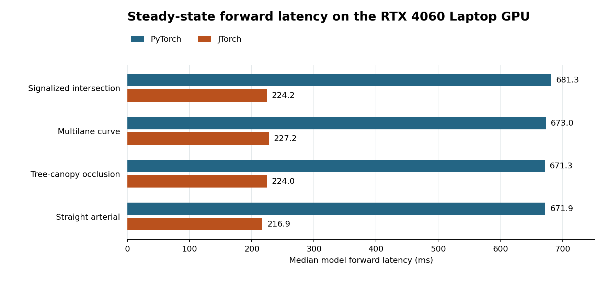
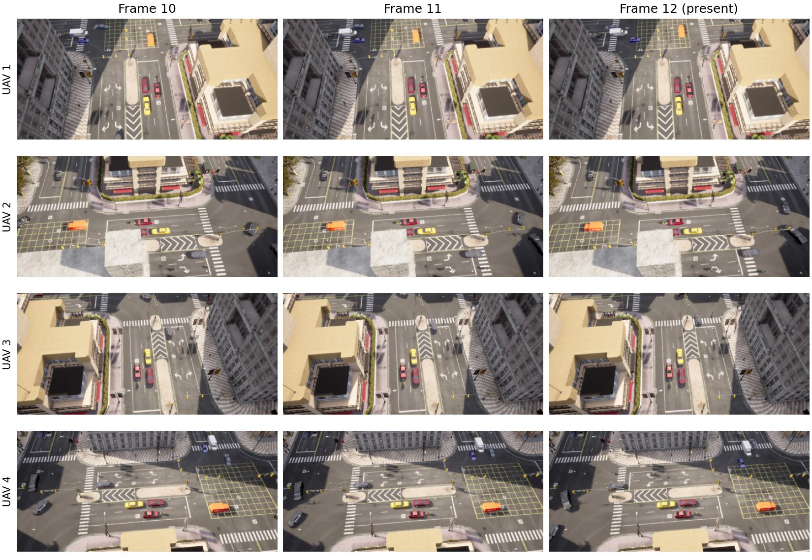
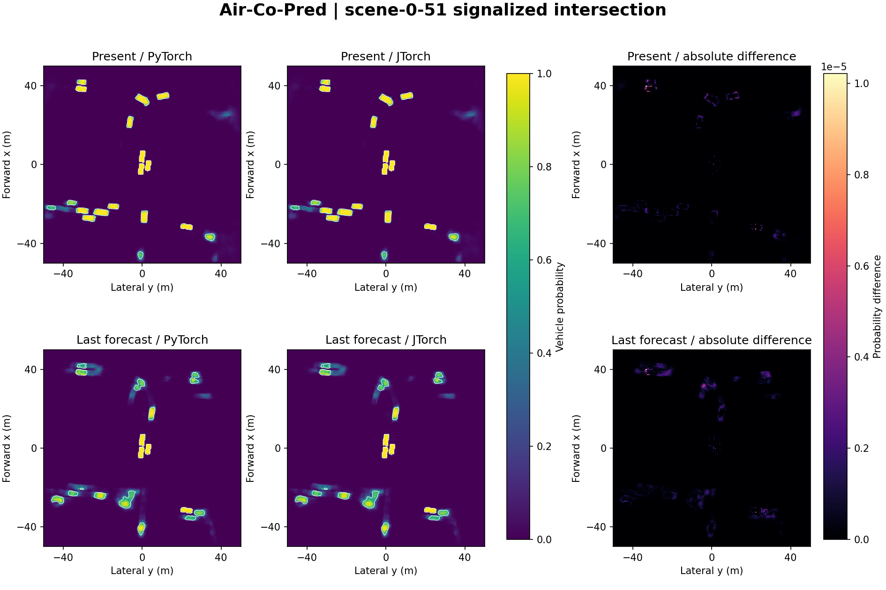
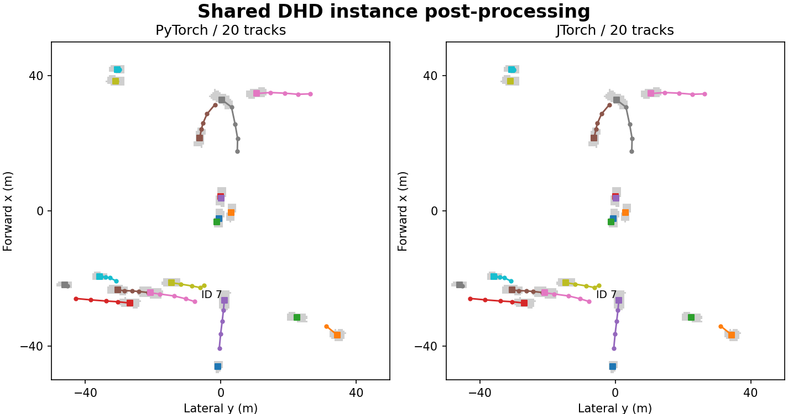
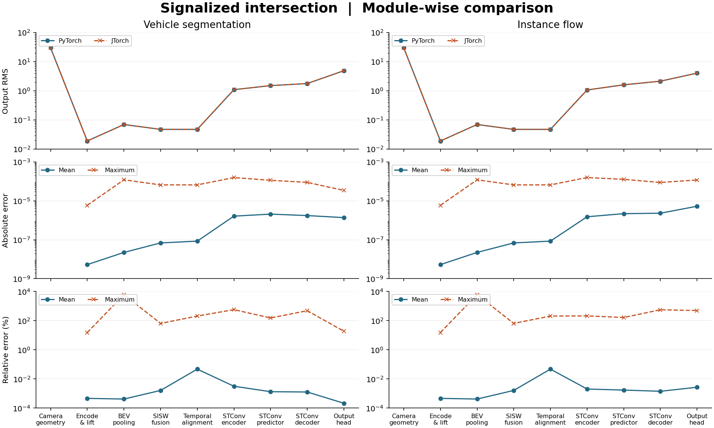

# DHD-Jittor

DHD-Jittor runs **Drones Help Drones** using JTorch and Jittor. The model combines four UAV camera views over three input frames to predict bird's-eye-view (BEV) vehicle segmentation and instance flow. The scene command takes raw images and camera poses as input and writes probability maps, instance IDs and trajectories. JTorch provides the `torch` interface throughout inference.

[NeurIPS 2024 paper](https://arxiv.org/abs/2405.14674) · [Original DHD implementation](https://github.com/WangzcBruce/DHD) · [Air-Co-Pred dataset](https://huggingface.co/datasets/BRUCE-WZC/AIR) · [JTorch](https://github.com/JITTorch/jtorch)

## Run the intersection example

Use an x86-64 Linux or WSL2 shell with an NVIDIA driver, `g++`, `curl`, `tar` and `xz`. From the repository root, run the installer. It creates an isolated Python 3.11 environment, installs the pinned dependencies and checks CUDA execution. The default runtime directory is `~/.local/share/dhd-jtorch`. Set `DHD_JTORCH_RUNTIME` to choose another directory.

```bash
bash install_jtorch.sh
mkdir -p ckpt
```

**Checkpoint.** Obtain the converted DHD inference weights separately and place the file at `ckpt/dhd-inference-weights.npz`. The example uses the SISW + STConv configuration. The scene images and calibration are included in [the example directory](examples/air_co_pred_junction).

```bash
bash infer_scene_wsl.sh examples/air_co_pred_junction outputs/junction ckpt/dhd-inference-weights.npz
```

The first run compiles Jittor operators. Subsequent runs reuse the cache. The command writes four files under `outputs/junction/`.

| File | Contents |
| --- | --- |
| `predictions.npz` | FP32 segmentation logits and instance flow, each shaped `(1, 6, 2, 200, 200)` |
| `bev.npz` | Vehicle probability, semantic class and instance ID for each output grid |
| `tracks.json` | Instance IDs and trajectory centers in BEV grid coordinates (column, row), keyed by output time |
| `bev.png` | Vehicle probabilities at the present and final forecast times |

### Custom inputs

For raw scenes, follow the [example manifest](examples/air_co_pred_junction/scene.json). It specifies frame order, image paths, camera calibration and poses. For a preprocessed batch, use the following command. Add `--benchmark outputs/latency.json` to record synchronized forward times.

```bash
bash infer_jtorch_wsl.sh ckpt/dhd-inference-weights.npz outputs/predictions.npz --input /path/to/batch.npz
```

| FP32 input | Shape | Meaning |
| --- | --- | --- |
| `image` | `(1, T, 4, 3, 224, 480)` | Resized, cropped and normalized RGB views |
| `intrinsics` | `(1, T, 4, 3, 3)` | Intrinsics adjusted for resizing and cropping |
| `extrinsics` | `(1, T, 4, 4, 4)` | Camera-to-reference transforms |
| `future_egomotion` | `(1, T, 6)` | Relative ego motion between consecutive frames |

The example weights read the first three input frames. In the six output grids, index 1 is the present and index 5 is the last forecast.

## Comparison with upstream PyTorch

**Test environment.** NVIDIA GeForce RTX 4060 Laptop GPU, Ubuntu 24.04 on WSL2, batch size 1, FP32, TF32 disabled. The baseline used PyTorch 2.8.0+cu128 and upstream DHD revision `27c2e6b`. The port used JTorch 0.1.8, Jittor 1.3.11.0 and the CUDA 12.8 toolchain. Both backends used the same preprocessed inputs and weights from the same checkpoint.

### Air-Co-Pred results

Each row covers one four-camera window and six output times (240,000 BEV cells). MAE is the mean absolute difference between the two model outputs. Foreground IoU compares **the two predicted vehicle masks** and reports the lowest IoU across output times. [Full-precision results](docs/comparison/air_co_pred_results.json)

| Scene | Segmentation logit MAE | Instance flow MAE | Flow absolute error, P99 | Min. foreground IoU |
| --- | ---: | ---: | ---: | ---: |
| Signalized intersection (`scene-0-51`) | 1.43e-6 | 5.50e-6 | 3.41e-5 | 100% |
| Multilane curve (`scene-0-21`) | 1.02e-6 | 4.81e-6 | 3.05e-5 | 100% |
| Tree-canopy occlusion (`scene-0-31`) | 1.31e-6 | 5.88e-6 | 3.80e-5 | 100% |
| Straight arterial (`scene-0-191`) | 1.18e-6 | 5.07e-6 | 3.33e-5 | 100% |

### Forward latency

Both backends ran on the same RTX 4060 Laptop GPU in FP32 with batch size 1. After the first forward and five warm-up forwards, each backend timed 15 GPU-synchronized model forwards per scene. Timing starts with the inputs on the GPU and ends when the forward completes. Preprocessing, host output copies and trajectory decoding are outside this interval. The table reports the median (P50), 95th percentile (P95) and the ratio of PyTorch P50 to JTorch P50.



| Scene | PyTorch P50 (ms) | PyTorch P95 (ms) | JTorch P50 (ms) | JTorch P95 (ms) | P50 speedup |
| --- | ---: | ---: | ---: | ---: | ---: |
| Signalized intersection | 681.3 | 692.5 | 224.2 | 227.8 | 3.04× |
| Multilane curve | 673.0 | 693.6 | 227.2 | 232.3 | 2.96× |
| Tree-canopy occlusion | 671.3 | 673.7 | 224.0 | 230.0 | 3.00× |
| Straight arterial | 671.9 | 675.0 | 216.9 | 222.1 | 3.10× |

**First-run cost.** With an existing JIT cache, the first JTorch forward took 0.63–0.99 s across the four scenes. In separate runs with empty Jittor and CUDA compilation caches, the first forward took 92.59–97.35 s, including compilation. [Steady-state and cached first-forward measurements](docs/comparison/forward_latency.csv)

### Intersection case study

The example uses frames 10, 11 and 12 of `scene-0-51` (zero-based). Frame 12 is the present. Each row below follows one camera across the three frames.



The first two columns show vehicle probabilities on the same scale. The third shows their absolute difference on its own color scale. Both backends assigned the same semantic class to every BEV cell at all six output times.



With the same DHD instance decoder, both backends found **20 present-time vehicles**. All **82 matched trajectory centers** coincided, with a maximum displacement of **0.000 m**. [Per-instance measurements](docs/comparison/junction_comparison.json)



### Module-wise error

The columns follow the segmentation and instance-flow branches. The three rows show output root mean square (RMS), absolute error, and element-wise relative error. Relative error is computed as `abs(JTorch - PyTorch) / max(abs(PyTorch), 1e-6)`; the charts show percentages, and the CSV stores ratios. Each metric uses the same log scale across the four scenes. Zero errors are omitted from log axes.

Camera geometry matched exactly in all four scenes. The largest absolute module error was **5.34e-4** in the instance-flow STConv encoder for tree-canopy occlusion. Its mean absolute error was **1.53e-6**. The largest mean element-wise relative error across modules was **0.0474%**, at temporal alignment in the intersection. [All module measurements](docs/comparison/air_co_pred_module_metrics.csv)



| Other Air-Co-Pred scenes | Module-wise plots |
| --- | --- |
| Multilane curve | [View figure](docs/comparison/modules_curve.png) |
| Tree-canopy occlusion | [View figure](docs/comparison/modules_occlusion.png) |
| Straight arterial | [View figure](docs/comparison/modules_arterial.png) |

### Additional diagnostic cases

These archived comparisons use a rendered intersection and four virtual camera views derived from the UC Merced Land Use dataset's `parkinglot47` aerial photograph. The parking-lot views repeat over three frames. The last row of the diagnostic module plots reports relative L2 error, the norm of the difference divided by the PyTorch tensor norm.

| Input | Camera views | Vehicle probability | Instance tracks | Saved measurements |
| --- | --- | --- | --- | --- |
| Rendered intersection | [Input frames](docs/comparison/road_inputs.jpg) | [BEV comparison](docs/comparison/road_bev_comparison.png) | [7 tracks per backend](docs/comparison/road_instance_tracks.png) | [JSON](docs/comparison/road_comparison.json) |
| Reprojected parking lot | [Source and views](docs/comparison/real_inputs.jpg) | [BEV comparison](docs/comparison/real_bev_comparison.png) | [5 tracks per backend](docs/comparison/real_instance_tracks.png) | [JSON](docs/comparison/real_comparison.json) |

Diagnostic module traces: [static synthetic input](docs/comparison/modules_static.png), [synthetic ego motion](docs/comparison/modules_moving.png), [rendered intersection](docs/comparison/modules_road.png), [reprojected parking lot](docs/comparison/modules_real.png). [Trace data](docs/comparison/diagnostics_module_metrics.csv)

## Acknowledgments and citation

This port builds on the model, checkpoint format and Air-Co-Pred dataset developed by the DHD authors. The original repository provides training and dataset-wide evaluation instructions. [Upstream DHD](https://github.com/WangzcBruce/DHD)

```bibtex
@inproceedings{wang2024drones,
  title={Drones Help Drones: A Collaborative Framework for Multi-Drone Object Trajectory Prediction and Beyond},
  author={Wang, Zhechao and Cheng, Peirui and Chen, Mingxin and Tian, Pengju
          and Wang, Zhirui and Li, Xinming and Yang, Xue and Sun, Xian},
  booktitle={Advances in Neural Information Processing Systems},
  year={2024}
}
```
